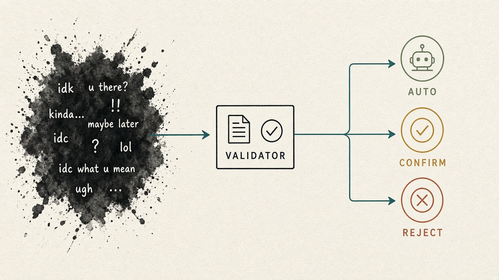
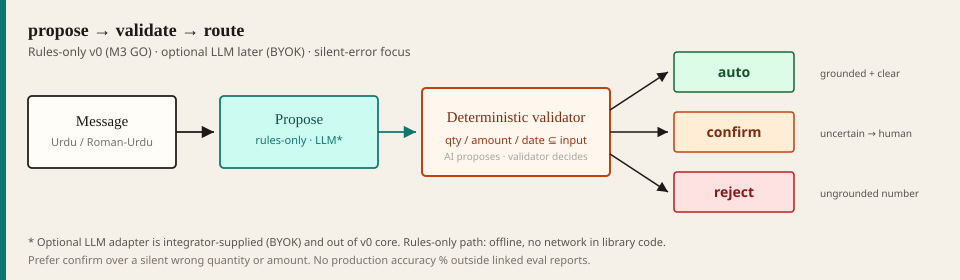
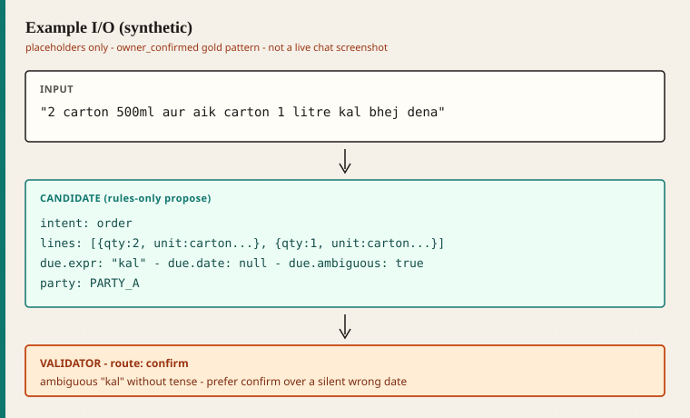
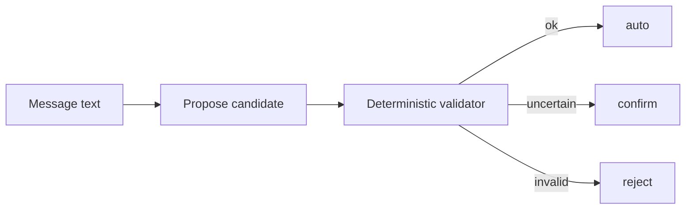

# urdu-business-nlu

> **M3 GO — rules-only v0.** TypeScript library: normalisers, rules-only `propose`/`extract`, deterministic validator and router. Silent-error focus (prefer confirm over a wrong quantity/amount). Optional LLM is BYOK and later. Contact: arsalanarshad.dev@gmail.com



_Abstract diagram only — not a product screenshot. No WhatsApp/Meta branding._

<p align="center">
  
</p>

## Hosting (what this is)

This is an **npm/TypeScript library + eval set**, not a hosted SaaS. Source lives on **GitHub**; when the package is published, consumers install it with npm. There is **no Railway/app hosting** for the core product, and no always-on API in v0. An optional hosted API remains a possible later add-on and is out of scope for this release.

**CI (pending):** GitHub Actions is not on `main` yet — the token lacked the `workflow` OAuth scope, so the workflow is parked at [`.github/ci.yml.pending`](.github/ci.yml.pending). Branch/tag rulesets are already applied. After `gh auth refresh -h github.com -s workflow`, restore the file to `.github/workflows/ci.yml` and push.

## What this is

An open-source (**MIT**) TypeScript library plus an in-repo synthetic eval set (public dataset licence **CC-BY-4.0** when/if published separately — **not legal advice**; gold is in `eval/gold/**` today, not a separate data release) that turns informal Urdu, Roman-Urdu and mixed-English business messages (orders, payments, credit/udhaar, delivery) into **validated structured records**. A deterministic validator checks every number, unit and date; anything uncertain goes to human confirmation.

**Not in scope for v0:** WhatsApp bot, Meta Business API, ledger storage, payments, ASR, or a hosted API.

Source of truth: [`PROJECT_CONTEXT.md`](PROJECT_CONTEXT.md) · [`docs/SPEC.md`](docs/SPEC.md) · [`docs/DATA_AND_PRIVACY.md`](docs/DATA_AND_PRIVACY.md) · [`docs/BUILD_PLAN.md`](docs/BUILD_PLAN.md)

## Status (honest)

| Item | State |
|---|---|
| Hypothesis | Unvalidated — builders may lack an open, tested Urdu/Roman-Urdu business-message parser + eval |
| Library | **M3 GO** rules-only v0 — `src/` normalisers + `propose`/`extract` + `validateRecord` + `route` |
| npm publish | **Not published** (install from source / local `npm install` for now) |
| Eval decision | [M3 go/no-go](docs/eval-reports/M3-go-no-go-2026-11-04.md) · [gold baseline](docs/eval-reports/rules-only-gold-baseline-2026-11-03.md) — cite reports; **no marketing accuracy %** |
| Spikes | [N1](docs/spikes/N1-2026-10-31.md) · [N3](docs/spikes/N3-2026-11-03.md) · [N4](docs/spikes/N4-2026-10-31.md); N2 LLM/hybrid arms deferred (no key) |
| Gold | **101** `owner_confirmed` in [`eval/gold/`](eval/gold/); synthetic placeholders only |
| LLM | Optional BYOK adapter — **later** (M4 deferred) |
| CI | **Pending** — restore `.github/ci.yml.pending` → `.github/workflows/ci.yml` after `gh auth refresh -h github.com -s workflow` |

## Install / commands (local)

```bash
npm install
npm test
npm run build
```

## Usage (rules-only core)

```ts
import { propose, extract, validateRecord, route } from "urdu-business-nlu";

// Rules-only path: text → candidate (already validated + routed)
const record = propose("PARTY_A ko 5 carton oil bhej do");
// record.route === "auto" | "confirm" | "reject"
// extract(text) is the same rules-only function until an LLM adapter (later)

// Or propose a candidate yourself and validate:
const { issues } = validateRecord(record, "PARTY_A ko 5 carton oil bhej do");
route(issues);
```

Every number in a candidate must be traceable (after normalisation / number-word parse) to the input. Ungrounded qty/amount → `reject`. Ambiguous `kal`, missing currency/direction, etc. → `confirm`.

<p align="center">
  
</p>

## Architecture

Message → propose (rules-only now; optional LLM later, BYOK) → deterministic validator → `auto` | `confirm` | `reject`.



## Data & privacy

Synthetic or explicitly consented, anonymised samples only. No scraping, no real chats in the repo. Draft contributor consent lives in the [N4 spike](docs/spikes/N4-2026-10-31.md) (**not legal advice**). Code is **MIT**. Eval data intended **CC-BY-4.0** when/if published as a separate dataset — **not published separately yet**; gold remains in this repo. See [`docs/DATA_AND_PRIVACY.md`](docs/DATA_AND_PRIVACY.md).

## Contributing / security / licence

See [`CONTRIBUTING.md`](CONTRIBUTING.md), [`CODE_OF_CONDUCT.md`](CODE_OF_CONDUCT.md), [`SECURITY.md`](SECURITY.md), [`LICENSE`](LICENSE) (MIT).
